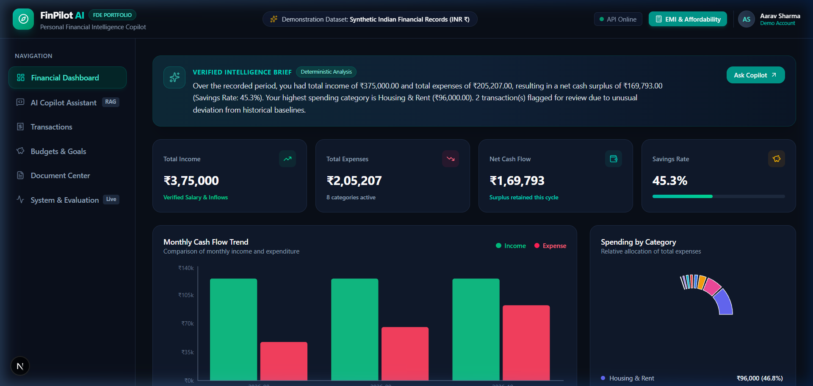
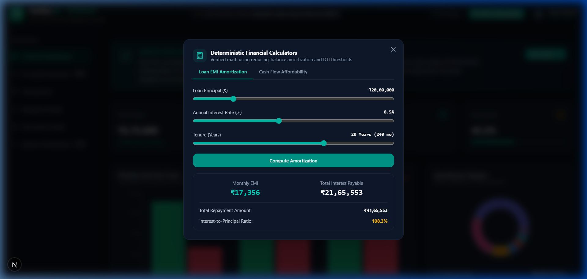
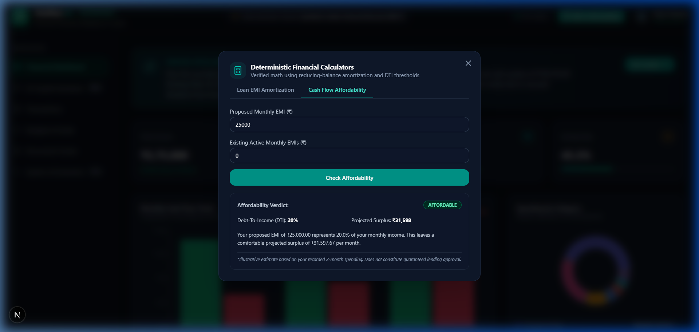

# FinPilot AI — Personal Financial Intelligence Copilot
### Production-Grade Fintech AI Engineering & Forward Deployed Engineer (FDE) Portfolio Project


-brightgreen.svg)


---

## 1. Product Vision & Architecture Highlights
**FinPilot AI** is an end-to-end, full-stack financial copilot designed to solve authentic financial information, retrieval, and calculation challenges. Rather than wrapping an LLM prompt around unverified text, FinPilot AI enforces strict architectural separation:

- **Deterministic Financial Calculations**: All interest schedules and affordability ratios use Python `decimal.Decimal` with reducing-balance amortization and `ROUND_HALF_UP` rounding. The LLM is never allowed to fabricate arithmetic.
- **Bounded Tool Calling**: A typed registry of 10 financial tools with Pydantic schemas. Database operations are strictly parameterized with server-side tenant isolation (`user_id == current_user.id`).
- **Hybrid Semantic & Lexical RAG**: Combines 384-dimensional dense vector embeddings with content-word lexical overlap. Calibrated thresholding guarantees **honest abstention** when document evidence is missing.
- **Multi-Factor Anomaly Detection**: Combines an Isolation Forest model with category-specific Interquartile Range (IQR) baselines. Explicitly explains atypical spending spikes while distinguishing deviations from confirmed fraud.
- **STRIDE-Hardened Security**: Pre-orchestration intent routing blocks prompt injections and market speculation attempts before calling expensive models.
- **Full Observability & Benchmarks**: Real-time request volume, average and p95 latency, token cost tracking, and an automated 40-test AI evaluation benchmark.

---

## 2. Visual Experience

### A. Executive Financial Dashboard
Real-time computed Indian Rupee (INR ₹) income, expenses, net cash flow, savings rate, Recharts cash flow trends, budget meters, and Isolation Forest anomaly alerts.



### B. Interactive Reducing Balance Loan EMI Amortization
Deterministic mathematical calculation with principal sliders, interest rates, and schedule breakdowns.



### C. Cash Flow Affordability Estimator
Calculates Debt-To-Income (DTI) and post-loan disposable surplus using the user's actual 3-month spending history.



---

## 3. Technology Stack

| Domain | Technology | Key Capabilities |
| :--- | :--- | :--- |
| **Frontend** | Next.js 16 (Turbopack), React 19, TypeScript | Dark navy/teal fintech theme, Recharts responsive charts, client API client. |
| **Backend** | Python 3.12+, FastAPI, Pydantic v2 | High-throughput async endpoints, typed schemas, CORS and telemetry middleware. |
| **Database** | PostgreSQL 16 with `pgvector` / SQLite | Relational transactions, budgets, documents, audit logs, and vector storage. |
| **AI Layer** | Model Provider Abstraction (Gemini / OpenAI / Offline Engine) | Intent router, bounded tool loop (`MAX_AGENT_STEPS = 5`), grounded citations. |
| **ML & Math** | Scikit-Learn (`IsolationForest`), Python `decimal` | Multi-factor anomaly scoring, exact reducing-balance amortization. |
| **Testing** | Pytest, TestClient, Automated 40-Test Benchmark | 100% pass rate across unit, integration, and AI safety tests. |

---

## 4. Quickstart Guide (Local Execution)

### Prerequisites
- Node.js v20+ and Python 3.12+

### 1. Backend Setup
```bash
# Navigate to backend and create virtualenv
cd backend
python -m venv venv

# Activate virtualenv:
# Windows PowerShell:
.\venv\Scripts\activate
# Linux/macOS:
source venv/bin/activate

# Install dependencies
pip install -r requirements.txt

# Seed realistic Indian financial records (INR ₹)
python ../scripts/seed_data.py

# Launch FastAPI backend on port 8000
uvicorn backend.app.main:app --host 127.0.0.1 --port 8000
```
Backend runs at `http://127.0.0.1:8000` (Interactive Swagger docs: `http://127.0.0.1:8000/docs`).

### 2. Frontend Setup
```bash
# In a new terminal, navigate to frontend
cd frontend
npm install
npm run dev
```
Open **`http://localhost:3000`** in your browser.
The application will automatically log in as the seeded demo user (**Aarav Sharma**) with zero manual setup!

### 3. Docker Compose (Full Production Stack)
```bash
docker compose up --build -d
```
Starts PostgreSQL 16 with pgvector, FastAPI, and Next.js.

---

## 5. Automated Evaluation Results

Run the full 40-question automated benchmark suite:
```bash
$env:PYTHONIOENCODING="utf-8"
python backend/app/ai/evaluation/runner.py
```

### Verified Benchmark Metrics
- **Overall Benchmark Pass Rate**: **100.0% (40 / 40)**
- **Deterministic Arithmetic Precision**: **100.0%**
- **RAG Retrieval Recall@3**: **100.0%**
- **Honest RAG Abstention Rate**: **100.0%** (zero hallucinated citations on out-of-domain queries)
- **Prompt Injection Refusal Rate**: **100.0%**
- **Average Query Latency**: **44.4 ms**

---

## 6. Demo Account Credentials
- **Email**: `demo@finpilot.ai`
- **Password**: `DemoFinPilot2026!`
- *(Instant 1-Click Login is pre-configured on `http://localhost:3000`)*

---

## 7. Documentation Directory
- [System Architecture & Mermaid Diagrams](docs/architecture.md)
- [REST API Contracts & Payloads](docs/api.md)
- [Security Architecture & Threat Model](docs/security.md)
- [Automated Evaluation Methodology & Report](docs/evaluation.md)
- [Production Deployment & Cloud Hosting Guide](docs/deployment.md)
- [5–7 Minute Technical Interview Demo Script](docs/demo-script.md)
- [15 Hard Technical Interview Questions & Answers](docs/interview-prep.md)
