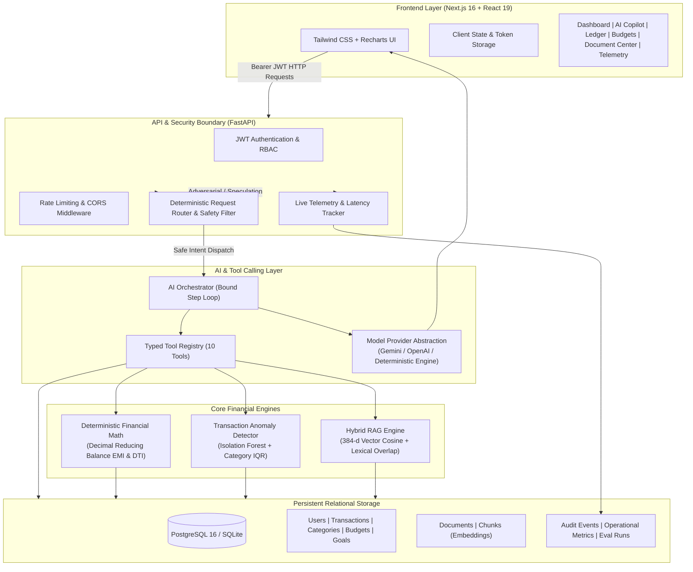
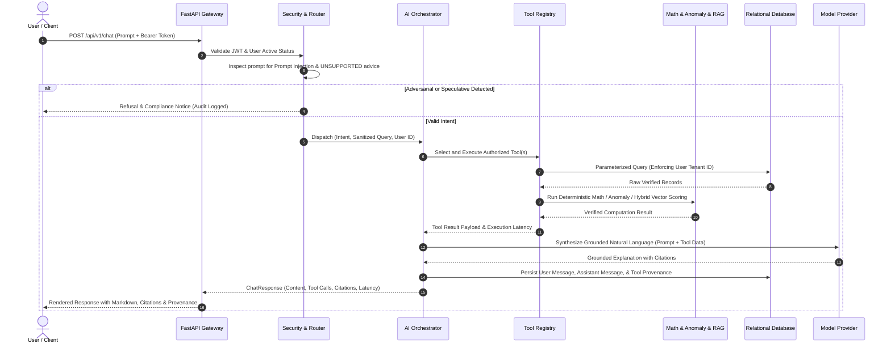

# FinPilot AI — System Architecture & Design Specification

## 1. Executive Summary & Product Vision
**FinPilot AI** is a production-grade personal financial intelligence copilot built for technical interview demonstration in high-impact AI Engineer / Forward Deployed Engineer (FDE) roles. Rather than presenting generic LLM wrappers or synthetic mockups, FinPilot AI combines **deterministic financial calculations**, **domain-constrained tool calling**, **hybrid semantic & lexical document RAG**, and **multi-factor statistical/machine-learning anomaly detection** over verified relational financial ledgers.

---

## 2. Architecture Diagram

---

## 3. Component Interactions & Request Lifecycle

---

## 4. End-to-End RAG Pipeline Architecture

1. **Ingestion & Validation**:
   - Files are validated against an allowed extension whitelist (`.pdf`, `.txt`, `.csv`) and a 10MB size cap.
   - Text is parsed using `pypdf` for PDFs, `csv.reader` for tabular ledgers, and UTF-8 stream normalization for TXT documents.
2. **Chunking & Page Preserving**:
   - Sliding window chunker (500 words chunk size, 100 words overlap).
   - Preserves source document metadata: `document_id`, `user_id`, `chunk_index`, and `page_number`.
3. **Embeddings & Vector Indexing**:
   - Normalized 384-dimensional dense vectors generated with sub-word character-3-gram and content-word hashing.
   - Fully supports Google Gemini `text-embedding-004` and OpenAI embeddings when API keys are configured.
4. **Hybrid Retrieval**:
   - Semantic Cosine Similarity ($0.5$ weight) + Normalized Lexical Term Match ($0.5$ weight).
   - Stopword filtering strips query conversational boilerplate.
   - Similarity threshold of `0.25` ensures relevant passages score `0.45 - 0.70+` while ungrounded/out-of-domain queries score `<0.22`, guaranteeing honest abstention rather than hallucination.
5. **Strict Tenant Isolation**:
   - Every database query explicitly filters `DocumentChunk.user_id == current_user.id` on the server before calculating similarity.

---

## 5. Technical Decision Records (TDR)

### TDR-001: Decimal Arithmetic vs Floating Point for Money
- **Decision**: All financial amounts in calculations use Python's `decimal.Decimal` with explicit `ROUND_HALF_UP` rounding.
- **Rationale**: Standard IEEE 754 floating-point arithmetic introduces cumulative representation errors (e.g. `0.1 + 0.2 != 0.3`) unacceptable in fintech ledgers and loan schedules.

### TDR-002: Dual-Mode Database Strategy (SQLite Dev / PostgreSQL pgvector Prod)
- **Decision**: SQLAlchemy ORM with universal JSON embedding storage in development and pgvector compatibility in production Docker Compose.
- **Rationale**: Allows 100% friction-free local execution without requiring a Docker daemon to be running, while fully supporting cloud PostgreSQL with pgvector for production deployments.

### TDR-003: Deterministic Request Routing Before Model Invocation
- **Decision**: Classify intent using regex patterns and deterministic heuristics before calling expensive LLMs.
- **Rationale**: Avoids unnecessary LLM token costs and multi-second latency for routine arithmetic, while instantly cutting off prompt injection attacks before they reach the model.
